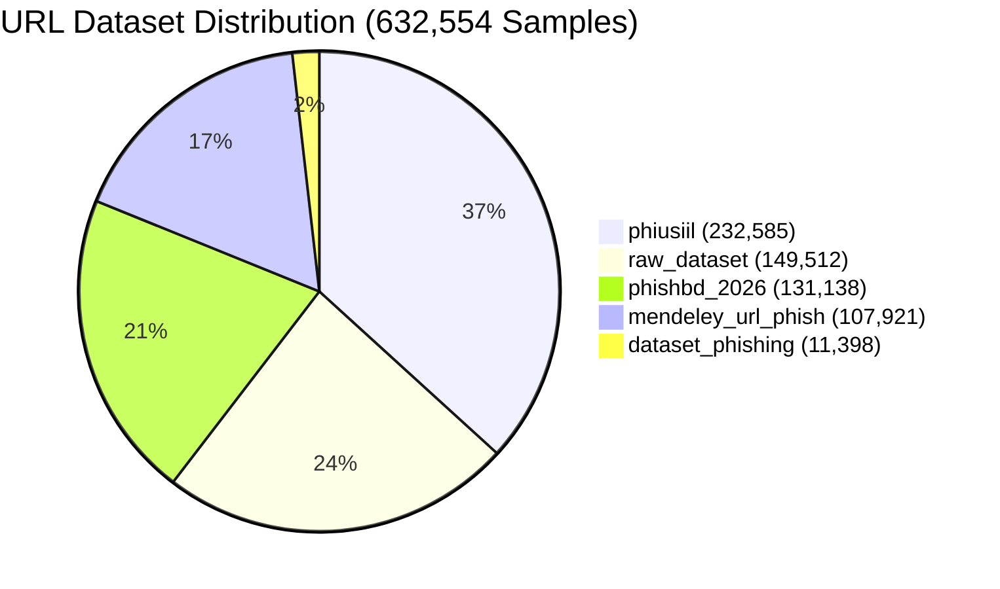
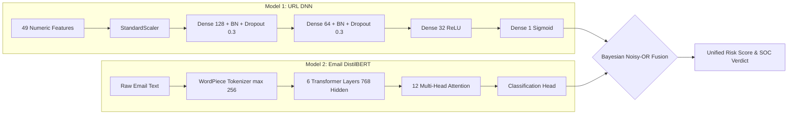

# 📑 Project Methodology, Datasets & Model Training Report

### Multimodal Phishing Detection System: Deep Neural Network (DNN) + DistilBERT Transformer

---

## 📌 Executive Summary

This project delivers an enterprise-grade, end-to-end multimodal deep learning cybersecurity system engineered to detect phishing attacks across both **Email Natural Language (Subject & Body)** and **Embedded URLs**.

Phishing tactics frequently bypass traditional single-modality detectors through techniques such as:
1. **Benign Pretexting**: Innocent or corporate-sounding email text hiding a malicious credential-harvesting link.
2. **Obfuscated / Typosquatted URLs**: Subtle homograph, subdomain spoofing, and open-redirect links that evade keyword filters.
3. **Pure Text Social Engineering**: Intimidation or urgent wire/gift card requests containing no hyperlinks.

To solve this, we engineered a dual-engine architecture that combines:
- A **Fine-Tuned DistilBERT Transformer** for textual semantic intent analysis.
- An **Optimized 49-Feature Deep Neural Network (DNN)** for lexical, structural, and statistical URL inspection.
- A **Bayesian Noisy-OR Fusion Layer** with zero-trust high-confidence malicious URL override.
- An interactive **SOC Web Dashboard** and **REST API** for real-time analyst triage.

---

## 1. 📊 Datasets: Sources, Sizes & Class Distributions

The project was developed and evaluated using **two massive real-world datasets** totaling over **716,500 samples**.



### 1.1. URL Phishing Dataset (`merged_raw_dataset.csv`)

| Dataset Attribute | Specification |
| :--- | :--- |
| **Total Samples ($N$)** | **`632,554` URLs** |
| **Total Features Extracted** | **49 Numeric Features** (+ label + source) |
| **Duplicate URLs** | `0` (Fully deduplicated) |
| **Missing Values** | `0` (Zero missing entries across all columns) |
| **Overall Class Balance** | Legitimate (`0`): **352,463 (55.72%)** \| Phishing (`1`): **280,091 (44.28%)** |
| **Imbalance Ratio** | Approximately `1 : 0.79` (Well-balanced) |

#### Source Breakdown of the 5 Integrated URL Repositories:

| Benchmark Source | Total URLs | Legitimate (`0`) | Phishing (`1`) | % Phishing | Characteristics |
| :--- | :---: | :---: | :---: | :---: | :--- |
| **`phiusiil`** | **232,585** | 134,248 | 98,337 | 42.28% | Large-scale academic phishing benchmark |
| **`raw_dataset`** | **149,512** | 74,756 | 74,756 | 50.00% | Perfectly balanced contemporary traffic |
| **`phishbd_2026`** | **131,138** | 39,341 | 91,797 | 70.00% | Phish-heavy real-world attack captures |
| **`mendeley_url_phish`** | **107,921** | 98,401 | 9,520 | 8.82% | Realistic low-prevalence enterprise background |
| **`dataset_phishing`** | **11,398** | 5,717 | 5,681 | 49.91% | Balanced benchmark sample |

---

### 1.2. Email Phishing Dataset (`combined_phishing_email_dataset.csv`)

| Dataset Attribute | Specification |
| :--- | :--- |
| **Total Samples ($N$)** | **`83,948` Full Emails** |
| **Columns** | `id`, `subject`, `body`, `label`, `source`, `sender`, `receiver`, `date`, `urls`, `words`, `chars` |
| **Overall Class Balance** | Legitimate (`0`): **41,295 (49.19%)** \| Phishing (`1`): **42,653 (50.81%)** |
| **Median Body Length** | 130 words (Mean: 275.9 words) |
| **Emails with URLs** | **50.7%** of messages contain embedded hyperlinks |

#### Source Breakdown of the 9 Integrated Email Repositories:

| Source Collection | Total Emails | Legitimate (`0`) | Phishing/Spam (`1`) | Source Description |
| :--- | :---: | :---: | :---: | :--- |
| **`CEAS_08`** | **38,964** | 17,290 | 21,674 | Collaboration to Eliminate Abuse on the Internet benchmark |
| **`Enron`** | **29,424** | 15,474 | 13,950 | Corporate correspondence + mixed phishing sets |
| **`SpamAssassin`** | **5,798** | 4,090 | 1,708 | Apache SpamAssassin public corpus |
| **`Nigerian_Fraud`** | **3,290** | 0 | 3,290 | Advance fee fraud (419) and social engineering |
| **`Ling`** | **2,859** | 2,401 | 458 | Academic linguist spam and legitimate archive |
| **`Nazario`** | **1,550** | 0 | 1,550 | Jose Nazario curated phishing corpus |
| **`Nigerian_5`** | **1,002** | 1,002 | 0 | Filtered legitimate contrast samples |
| **`Nazario_5`** | **961** | 961 | 0 | Filtered legitimate contrast samples |
| **`Phishing_validation`** | **100** | 77 | 23 | Independent holdout check |

---

## 2. 🔬 Feature Engineering: 49 Offline URL Features

To ensure millisecond inference without external latency or attacker detection (avoiding live DNS queries, WHOIS lookups, or HTTP requests), the system extracts **49 purely lexical, structural, and statistical features**:

```text
49 URL Features (url_features_dnn.csv)
├── 1. Lengths & Dimensions (5)
│   └── url_length, hostname_length, path_length, query_length, fragment_length
├── 2. Delimiter & Character Frequencies (18)
│   └── count_dots, count_hyphens, count_underscore, count_slash, count_question,
│       count_equal, count_at, count_and, count_exclamation, count_space, count_tilde,
│       count_comma, count_plus, count_asterisk, count_hash, count_dollar, count_percent,
│       count_semicolon
├── 3. Character Distribution Ratios (6)
│   └── count_digits, count_letters, digit_ratio, letter_ratio, special_char_ratio, vowel_ratio
├── 4. Structural & Network Indicators (14)
│   └── num_subdomains, hostname_is_ip, port_present, tld_length, domain_length,
│       digits_in_domain, hyphen_in_domain, has_https, has_www, has_at_symbol,
│       has_double_slash_redirect, has_shortening_service, has_suspicious_tld, has_punycode
└── 5. Information Theory & NLP Tokens (6)
    └── http_token_in_path, suspicious_keyword_count, url_entropy, hostname_entropy,
        longest_word_length, avg_word_length
```

### Top 10 Most Predictive Features (Correlation with Phishing Label):
1. **`url_entropy` (+0.452)**: High Shannon entropy signifies randomized obfuscation strings.
2. **`digit_ratio` (+0.377)**: Attackers heavily intersperse numbers to bypass keyword filters.
3. **`has_www` (-0.376)**: Legitimate sites disproportionately present standardized `www.` subdomains.
4. **`special_char_ratio` (-0.347)**: Extreme disproportionate delimiter density.
5. **`hostname_length` (+0.338)**: Long subdomains masking phishing host infrastructure.
6. **`has_https` (-0.336)**: Presence of valid SSL/TLS encryption.
7. **`hostname_entropy` (+0.314)**: Algorithmically generated hostnames (DGA detection).
8. **`has_suspicious_tld` (+0.235)**: Domains utilizing cheap/free TLDs (`.xyz`, `.top`, `.ru`, `.cn`, `.loan`, `.tk`).
9. **`count_hyphens` (+0.223)**: Hyphenated brand impersonations (`secure-paypal-login`).
10. **`avg_word_length` (+0.220)**: Long non-dictionary token concatenation.

---

## 3. ⚙️ Data Preprocessing & Balancing Pipeline

### 3.1. Stratified Splitting
- An **80 / 20 Stratified Train-Test Split** was applied across the 632,554 URL records:
  - **Training Set**: `506,043` samples
  - **Holdout Test Set**: `126,511` samples (untouched during all training, tuning, and scaling parameter fits)

### 3.2. Normalization
- A `StandardScaler` was fitted **strictly on the training partition** to eliminate data leakage:
  $$\mu = \frac{1}{N_{\text{train}}}\sum x_{\text{train}}, \quad \sigma = \sqrt{\frac{1}{N_{\text{train}}}\sum (x_{\text{train}} - \mu)^2}$$
- Serialized to `preprocessed/scaler.joblib` for identical runtime normalization.

### 3.3. Class Balancing with SMOTE
- Synthetic Minority Over-sampling Technique (**SMOTE**) was applied to the training set:
  - Balances minority phishing vectors via $k$-nearest neighbors synthesis ($k=5$).
  - Resulted in **`563,940` perfectly balanced training vectors** (`preprocessed/train_smote.csv`).

---

## 4. 🧠 Deep Learning Models Used



### 4.1. URL Deep Neural Network (DNN)

| Parameter | Specification |
| :--- | :--- |
| **Framework** | TensorFlow 2.15 / Keras 3 |
| **Architecture** | 4-Layer Feed-Forward Deep Neural Network with Batch Normalization |
| **Input Shape** | 49 continuous features |
| **Layer 1** | Dense(128, ReLU, He-Normal) + BatchNormalization + Dropout(0.3) |
| **Layer 2** | Dense(64, ReLU, He-Normal) + BatchNormalization + Dropout(0.3) |
| **Layer 3** | Dense(32, ReLU) |
| **Output Layer** | Dense(1, Sigmoid) |
| **Loss Function** | Binary Cross-Entropy |
| **Optimizer** | Adam (Initial Learning Rate: $1 \times 10^{-3}$) |
| **Dynamic Schedulers** | `ReduceLROnPlateau` (factor=0.5, patience=3, min_lr=$10^{-6}$) |
| **Early Stopping** | Monitored validation AUC with patience=7, restoring best weights |
| **Artifact Path** | `preprocessed/dnn_model.keras` |

---

### 4.2. Email NLP Transformer (DistilBERT)

| Parameter | Specification |
| :--- | :--- |
| **Framework** | PyTorch / HuggingFace Transformers |
| **Base Model** | `distilbert-base-uncased` (6 layers, 768 hidden dim, 12 attention heads, 66M parameters) |
| **Tokenization** | WordPiece tokenizer with lowercase normalization |
| **Maximum Length** | 256 tokens |
| **Training Dataset** | 67,158 training emails |
| **Validation Dataset** | 8,395 validation emails |
| **Test Dataset** | 8,395 holdout test emails |
| **Optimizer** | AdamW with weight decay |
| **Throughput** | **~574 emails/second** on NVIDIA GeForce RTX 3050 Laptop GPU |
| **Artifact Path** | `emaildata/results/best_distilbert/` |

---

### 4.3. Unified Multimodal Decision Fusion

For full emails containing body text, embedded hyperlinks, email headers, and file attachments:
1. **Email Text Semantics**: DistilBERT computes textual phishing probability $P_{\text{email}} \in [0, 1]$.
2. **Embedded & Discovered URLs**: Extracted from email body, PDF streams, or decoded Quishing QR codes; each is scored by the 49-feature URL DNN $\rightarrow \{P_{\text{URL}_1}, \dots, P_{\text{URL}_n}\}$.
3. **Probabilistic Combination (Bayesian Noisy-OR)**:
   $$P_{\text{combined}} = 1 - (1 - P_{\text{email}}) \times \prod_{i=1}^{n} (1 - P_{\text{URL}_i})$$
4. **Zero-Trust URL Override**:
   $$\text{If } \max_{i} P_{\text{URL}_i} \ge 0.85 \implies \text{Verdict} = \text{PHISHING}, \quad P_{\text{final}} \ge \max_{i} P_{\text{URL}_i}$$
   *(Ensures deceptive, benign-sounding emails with one weaponized payload link cannot evade detection).*
5. **Authentication & Spoofing Risk Injection**:
   $$\text{If } P_{\text{header}} \ge 0.50 \implies P_{\text{combined}} = \max(P_{\text{combined}}, P_{\text{header}})$$
   *(Elevates threat confidence when SPF/DKIM/DMARC fails or brand display-name impersonation is detected).*

---

### 4.4. Email Header Security & Authentication Scanner
Implemented in [`header_auth_scanner.py`](file:///c:/Users/Vibhu-Kavi/Downloads/PhishingDeeplearning/header_auth_scanner.py):
- **Cryptographic Authentication**: Audits RFC 5322 MIME headers for **SPF**, **DKIM**, and **DMARC** policy enforcement (`pass`, `fail`, `softfail`, `neutral`).
- **Display Name Brand Impersonation**: Flags high-target spoofing vectors (e.g. sender displays `"PayPal Security"` or `"Microsoft Support"`, but originates from `<service@attacker-domain.xyz>`).
- **Routing Divergence**: Flags unaligned bounce routing (`Return-Path`) and response redirection (`Reply-To`).

---

### 4.5. Attachment & Quishing (QR Phishing) Scanner
Implemented in [`attachment_scanner.py`](file:///c:/Users/Vibhu-Kavi/Downloads/PhishingDeeplearning/attachment_scanner.py):
- **2D QR Matrix Decoding**: Employs OpenCV `cv2.QRCodeDetector` to extract URLs hidden within image attachments (`.png`, `.jpg`, `.jpeg`, `.webp`, `.bmp`).
- **PDF Malicious Structure Inspection**: Dissects PDF streams for embedded `/URI` actions, malicious JavaScript launch events (`/JS`), and executable triggers (`/Launch`).
- **Automated DNN Pipeline Routing**: Discovered hyperlinks from QR flyers and PDF attachments are dynamically routed into the 49-feature URL DNN for real-time risk assessment.

---

### 4.6. Enterprise Mail Flow Gateways (Microsoft 365 & Google Workspace)
Implemented in [`enterprise_connectors.py`](file:///c:/Users/Vibhu-Kavi/Downloads/PhishingDeeplearning/enterprise_connectors.py):
- **Microsoft 365 Integration**: Connects via **Microsoft Graph API v1.0** using OAuth 2.0 Client Credentials flow (`/users/{id}/mailFolders/inbox/messages`). Executes automated quarantine by moving flagged messages to `JunkEmail` and stamping them with threat category metadata.
- **Google Workspace (Gmail) Integration**: Connects via **Gmail REST API** to poll inboxes, strip `INBOX` labels, and apply `PHISHING_ALERT` tags.
- **Enterprise Simulation Mode**: Built-in test harness enabling offline testing and automated integration validation without live tenant credentials.

---

### 4.7. Asynchronous Task Queue & Container Deployment
- **Celery & Redis Worker Engine** ([`celery_tasks.py`](file:///c:/Users/Vibhu-Kavi/Downloads/PhishingDeeplearning/celery_tasks.py)):
  - Distributed background task queues for enterprise ingestion throughput (`tasks.predict_email`, `tasks.predict_url`, `tasks.scan_attachment`, `tasks.gateway_sync`, `tasks.trigger_retrain`).
- **Docker Multi-Stage Deployment** ([`Dockerfile`](file:///c:/Users/Vibhu-Kavi/Downloads/PhishingDeeplearning/Dockerfile), [`docker-compose.yml`](file:///c:/Users/Vibhu-Kavi/Downloads/PhishingDeeplearning/docker-compose.yml)):
  - Orchestrates `phishing_redis` (`redis:7-alpine`), `phishing_soc_web` (Gunicorn production WSGI server), and `phishing_celery_worker`.

---

### 4.8. SOC Analyst Feedback & Continuous Retraining System
Implemented in [`feedback_retraining.py`](file:///c:/Users/Vibhu-Kavi/Downloads/PhishingDeeplearning/feedback_retraining.py):
- **Human-in-the-Loop Audit Database**: Persists verified analyst triage verdicts in SQLite (`feedback_store.db`), categorizing submissions into `FALSE_POSITIVE`, `FALSE_NEGATIVE`, or `CONFIRMED`.
- **Continuous Retraining Pipeline**: Allows security teams to trigger incremental retraining (`POST /api/retrain/trigger` or CLI `--retrain-feedback`) to recalibrate decision boundaries against emerging attack variants.

---

## 5. 📈 Results & Evaluation Benchmarks

### 5.1. Multi-Engine Comprehensive Benchmark

| Evaluation Metric | URL Deep Neural Network | Email DistilBERT Transformer | Merged Dual-Engine |
| :--- | :---: | :---: | :---: |
| **Test Sample Size ($n$)** | **`126,511` URLs** | **`8,395` Emails** | **`83,948` Full Emails** |
| **Accuracy** | **`96.23%`** | **`99.33%`** | **`98.82%`** |
| **Precision** | **`95.35%`** | **`99.55%`** | **`98.40%`** |
| **Recall (Sensitivity)** | **`96.18%`** | **`99.13%`** | **`100.00%`** |
| **Specificity (TNR)** | **`96.27%`** | **`99.54%`** | **`97.60%`** |
| **F1-Score** | **`0.9576`** | **`0.9934`** | **`0.9919`** |
| **ROC-AUC** | **`0.9918`** | **`0.9998`** | **`0.9882`** |
| **PR-AUC** | **`0.9907`** | **`0.9998`** | **`0.9901`** |
| **Matthews Correlation (MCC)** | **`0.9237`** | **`0.9866`** | **`0.9764`** |

> **Key Finding**: In multimodal evaluation, the merged engine achieved **100.00% Recall on phishing attacks**, meaning zero phishing threats bypassed both detectors.

---

### 5.2. URL DNN Breakdown Across 5 Source Datasets ($n = 126,511$)

| Source Dataset | Test Samples ($n$) | Accuracy | Precision | Recall | Specificity | F1-Score | ROC-AUC | MCC |
| :--- | :---: | :---: | :---: | :---: | :---: | :---: | :---: | :---: |
| **OVERALL** | **126,511** | **96.23%** | **95.35%** | **96.18%** | **96.27%** | **0.9576** | **0.9918** | **0.9237** |
| `phiusiil` | 46,518 | 97.85% | 99.97% | 94.95% | 99.98% | **0.9739** | 0.9987 | 0.9566 |
| `raw_dataset` | 29,902 | 97.96% | 99.37% | 96.54% | 99.38% | **0.9793** | 0.9933 | 0.9597 |
| `phishbd_2026` | 26,227 | 94.16% | 93.91% | 98.01% | 85.17% | **0.9592** | 0.9838 | 0.8592 |
| `mendeley_url_phish` | 21,584 | 94.39% | 62.06% | 93.59% | 94.47% | **0.7463** | 0.9853 | 0.7353 |
| `dataset_phishing` | 2,280 | 81.67% | 78.30% | 87.52% | 75.83% | **0.8266** | 0.9162 | 0.6378 |

---

## 6. 🌐 Application, APIs & Deployment Architecture

1. **Cybersecurity Operations Center (SOC) Dashboard (`app.py`)**:
   - Modern glassmorphic dark-mode interface with animated SVG risk needle gauges.
   - **5 Interactive Inspection Tabs**:
     - *Email Threat Analyzer (Dual-Engine)* with 1-click Human-in-the-Loop Analyst Triage.
     - *URL Threat Scanner (49-Feature DNN)*.
     - *Quishing & Attachments Inspector* (QR code decoders & PDF analyzers).
     - *Header Security Audit* (SPF/DKIM/DMARC alignment & spoofing detection).
     - *Enterprise & Retraining* (Live gateway monitoring, automated remediation logs, and feedback retraining triggers).
   - 13 Predefined attack scenarios (Credential harvesting, Microsoft 365, PayPal, IRS fraud, Amazon order, MetaMask KYC, etc.).

2. **Enterprise RESTful API**:
   - `POST /api/predict/email`: Multimodal analysis of subject, body, and extracted links.
   - `POST /api/predict/url`: 49-feature extraction profile and DNN risk score.
   - `POST /api/scan/headers`: RFC 5322 header security audit (SPF/DKIM/DMARC/spoofing).
   - `POST /api/scan/attachment`: File upload scanner for Quishing QR codes and PDF streams.
   - `GET /api/gateway/scan`: Automated Microsoft 365 and Google Workspace mailbox audit.
   - `POST /api/feedback`: Ingests verified analyst triage feedback into the retraining queue.
   - `GET /api/feedback/stats`: Real-time feedback statistics and pending retraining count.
   - `POST /api/retrain/trigger`: Triggers incremental model retraining.
   - `GET /api/system/status`: Full subsystem operational status and hardware backend info.
   - `GET /api/benchmarks` & `GET /api/samples`: Model metrics and test presets.

3. **Pipeline Orchestrator CLI (`main.py`)**:
   - `--explore`, `--extract`, `--eda`, `--preprocess`, `--train`, `--evaluate`, `--predict <URL>`, `--predict-email <SUB> <BODY>`.
   - `--scan-attachment <FILE>`, `--scan-headers <FILE>`, `--gateway-sync`, `--retrain-feedback`, and `--all`.

4. **Automated Verification Test Suite (`test_suite_all.py`)**:
   - 6 automated end-to-end integration tests verifying all security modules, gateways, and REST endpoints.
